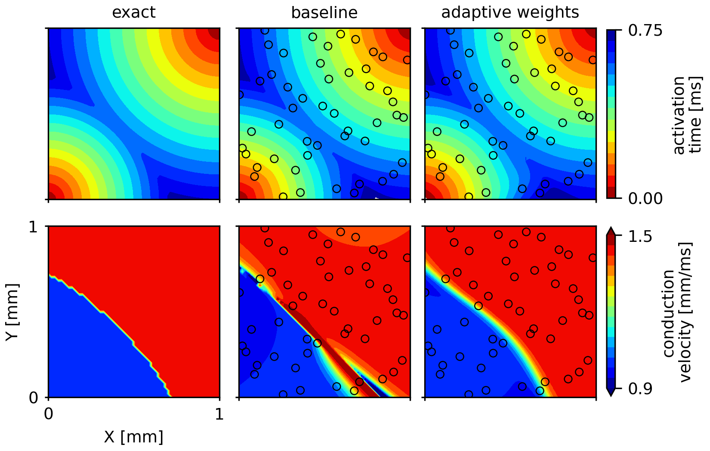
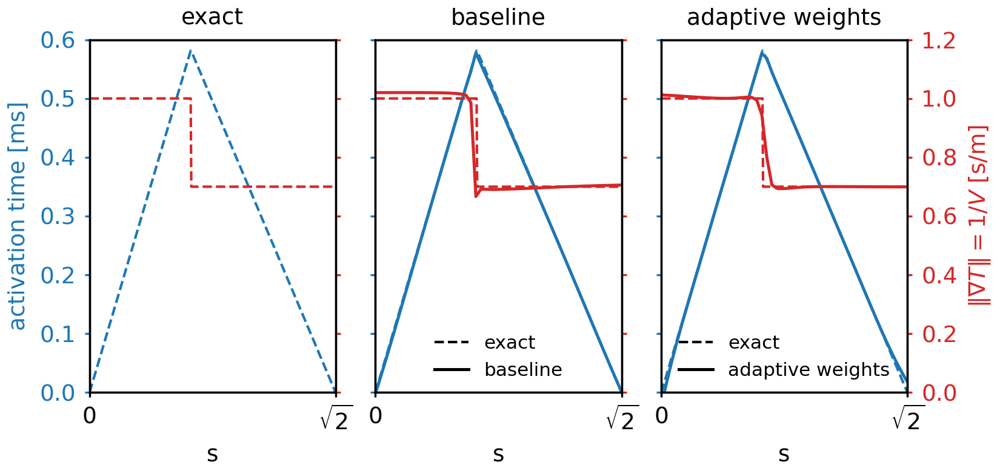

# EikonalNet in PyTorch

A PyTorch reimplementation of the two-dimensional benchmark from

> Sahli Costabal F, Yang Y, Perdikaris P, Hurtado DE, Kuhl E (2020).
> *Physics-informed neural networks for cardiac activation mapping.*
> Front. Phys. 8:42. https://doi.org/10.3389/fphy.2020.00042

The original TensorFlow 1.x code is at https://github.com/fsahli/EikonalNet.
**No code from the original repository is included here.** Everything in `src/`, `scripts/`
and `tests/` is an independent port, released under the MIT licence (see `LICENSE`).

The port reproduces the 0 % noise row of the paper's Table 1 (PINN column: nRMSE_T 0.49 %,
nMAE_V 3.56 %) and then adds, one at a time and in combination, adaptive loss weighting
(Wang, Teng, Perdikaris 2021, Algorithm 1), residual-based adaptive refinement (Lu et al.
2021, Sec. 2.8) and a ReLU activation-time network. Every number below comes from a run
directory under `results/`; the full account, including deviations from the paper, is in
`RESULTS.md`, and `report_assets/facts.md` lists every number in the tables and figures with
the directory it came from.

## Problem

On [0,1]^2, with r0 = |(x, y)| and r1 = |(x-1, y-1)|,

    T(x,y) = min(r0, 0.7 r1),   V(x,y) = 1 if r0 < 0.7 r1 else 1/0.7.

T satisfies the Eikonal equation V |grad T| = 1 away from the collision ridge r0 = 0.7 r1.
Fifty Latin-hypercube points carry measurements of T; V is never measured. Two networks
(T: five hidden layers of 20 tanh units; V: four hidden layers of 5 tanh units with a
1.5 sigmoid output) are trained on the five-term loss of the original code: data misfit,
Eikonal residual at the data points and at collocation points, a total-variation penalty on
V (weight 1e-7) and an L2 penalty on the T-network weights (weight 1e-9). Training is 50 000
Adam steps (learning rate 1e-3, a fresh Latin-hypercube batch of 100 collocation points per
step) followed by L-BFGS on the 50 x 50 evaluation grid. Metrics are the RMSE of T and the
MAE of V over the 2500 grid points, in percent (`nrmse_T = 100 x RMSE`, `nmae_V = 100 x MAE`),
which is how Table 1 of the paper is normalised.

## Install

    python -m venv .venv && source .venv/bin/activate
    pip install -r requirements.txt

`requirements.txt` pins the versions every result was produced with (Python 3.14.3,
torch 2.11.0, numpy 2.4.4, scipy 1.17.1, matplotlib 3.10.8; pytest for the tests). Everything
runs on CPU; a full run takes about 100 s on a laptop core.

## Tests

    python -m pytest tests

Fourteen tests: the exact fields satisfy the Eikonal equation away from the ridge, autograd
gradients match closed forms, the loss terms vanish for the exact solution, shapes, the
adaptive-weight and refinement helpers, and the plotting code.

## Dataset

`data/` holds the 50 measurement points (`data_points.npz`, `data_points.csv`: x, y,
T_measured, T_exact) and the 50 x 50 evaluation grid (`grid.npz`, `grid.csv`: x, y, T_exact,
V_exact). They are regenerated byte-for-byte by

    python scripts/make_data.py        # seed 1234

## Running

Every run writes `results/<run_name>/` with `config.json` (all flags, seeds, versions),
`metrics.json`, `loss.csv` (one column per loss term plus the adaptive weights), `fields.npz`
(predictions on the grid, the data points, the refinement points) and the two figures
`fig_fields.png` and `fig_loss.png`. `--seed` sets the initialisation, the collocation stream
and the noise; `--data_seed` sets the 50 point locations (defaults to `--seed`).

Single run, the paper's setting (Table 1 row, seed 1234):

    python scripts/train.py --run_name baseline_tanh_fixed --sigma 0

Five-seed protocol used for every variant in the table (data seed 1234, init seeds 0 to 4,
four runs in parallel with one torch thread each; run names `<prefix>_d1234_s<k>`):

    python scripts/run_seeds.py baseline_tanh_fixed   1234 0,1,2,3,4
    python scripts/run_seeds.py adaptive_datafit      1234 0,1,2,3,4 -- --weighting adaptive
    python scripts/run_seeds.py adaptive              1234 0,1,2,3,4 -- --weighting adaptive --adaptive_terms data,res_data,tv
    python scripts/run_seeds.py rar                   1234 0,1,2,3,4 -- --rar 1
    python scripts/run_seeds.py relu                  1234 0,1,2,3,4 -- --act relu
    python scripts/run_seeds.py residual_paper        1234 0,1,2,3,4 -- --residual paper
    python scripts/run_seeds.py adaptive_rar          1234 0,1,2,3,4 -- --weighting adaptive --rar 1
    python scripts/run_seeds.py adaptive_relu         1234 0,1,2,3,4 -- --weighting adaptive --act relu
    python scripts/run_seeds.py rar_relu              1234 0,1,2,3,4 -- --rar 1 --act relu
    python scripts/run_seeds.py adaptive_rar_relu     1234 0,1,2,3,4 -- --weighting adaptive --rar 1 --act relu

`--weighting adaptive` puts an adaptive weight on the two data-fit terms (data misfit and
residual at the data points), as in Algorithm 1 of Wang et al.; this is the variant called
"adaptive" or "adaptive (paper)" everywhere. `--adaptive_terms data,res_data,tv` additionally
weights the total-variation term; that variant ("adaptive (spec)") does not train and is kept as
a negative result. The shipped `adaptive_datafit` runs were made with the explicit flag
`--adaptive_terms data,res_data`, which is now the default (see each run's `config.json`).

Hard layout (data seed 2, init seeds 1234, 1, 2; run names `<prefix>_d2_s<k>`):

    python scripts/run_seeds.py adaptive_datafit  2 1234,1,2 -- --weighting adaptive
    python scripts/run_seeds.py relu              2 1234,1,2 -- --act relu
    python scripts/run_seeds.py adaptive_rar_relu 2 1234,1,2 -- --weighting adaptive --rar 1 --act relu

The baseline cells of that table come from `python scripts/train.py --run_name baseline_tanh_fixed_d2_s1234 --sigma 0 --data_seed 2 --seed 1234`,
the same with `--run_name baseline_tanh_fixed_d2_s1 --seed 1`, and `--run_name baseline_tanh_fixed_seed2 --seed 2`
(data seed defaults to the seed).

Noise, 1 % of max T added to the 50 measurements (indicative only; the paper's noise rows used
100 000 Adam steps without L-BFGS and 30 repeats):

    python scripts/run_seeds.py baseline_sigma0.01          1234 0,1,2,3,4 -- --sigma 0.01
    python scripts/run_seeds.py adaptive_rar_relu_sigma0.01 1234 0,1,2,3,4 -- --sigma 0.01 --weighting adaptive --rar 1 --act relu

Other flags: `--adam_steps`, `--lbfgs_iters`, `--lbfgs_max_eval`, `--dtype float64`,
`--anneal_every`, `--beta`, `--rar_every`, `--rar_m`, `--rar_candidates`, `--threads`.
A quick smoke configuration for development is `--adam_steps 2000 --lbfgs_iters 200`.

## Tables and figures

    python scripts/summarize.py --write                              # rewrites the variant table in RESULTS.md
    python scripts/make_report_assets.py --best_combo "adaptive+rar+relu"   # report_assets/: tables, facts.md, seed spread, loss histories
    python scripts/paper_style_figures.py --seed 1234 --out figs     # figs/fields_main, figs/section_main (Figures 1 and 2)
    python scripts/paper_style_figures.py --seed 0                   # report_assets/: the five-variant appendix figures
    python scripts/data_layout_diagnostic.py                         # results/data_layout_diagnostic/

The ‖∇T‖ curves in `report_assets/section_appendix.png` were evaluated from saved network
weights, which are not shipped; regenerating that figure draws it without those curves.

## Results

Mean (min to max) over data seed 1234, init seeds 0 to 4. Paper Table 1 (0 % noise, PINN): nRMSE_T 0.49, nMAE_V 3.56.
Copied from `report_assets/summary_table.md`.

| variant | nRMSE_T [%] | nMAE_V [%] | max err T | max err V | failed seeds |
|---|---|---|---|---|---|
| baseline | 0.70 (0.42 to 0.84) | 5.78 (2.56 to 9.74) | 0.058 (0.035 to 0.073) | 0.65 (0.42 to 0.95) | none |
| adaptive (spec: data, res_data, tv) | 2.32 (1.71 to 3.12) | 15.44 (13.70 to 16.92) | 0.217 (0.119 to 0.311) | 0.42 (0.36 to 0.46) | none |
| adaptive_datafit (paper: data, res_data) | 0.53 (0.20 to 0.89) | 2.75 (1.95 to 3.87) | 0.035 (0.015 to 0.049) | 0.42 (0.37 to 0.48) | none |
| rar | 2.81 (0.75 to 6.30) | 10.55 (6.98 to 14.81) | 0.162 (0.056 to 0.297) | 0.78 (0.50 to 1.18) | none |
| relu | 1.40 (0.86 to 2.33) | 6.74 (4.48 to 8.97) | 0.127 (0.059 to 0.298) | 0.30 (0.26 to 0.33) | none |
| residual paper (ablation) | 2.40 (1.23 to 3.41) | 10.33 (7.31 to 11.55) | 0.188 (0.128 to 0.239) | 0.97 (0.55 to 1.32) | none |
| adaptive+rar | 0.62 (0.26 to 0.93) | 3.42 (1.31 to 5.66) | 0.049 (0.021 to 0.070) | 0.38 (0.31 to 0.45) | none |
| adaptive+relu | 0.66 (0.54 to 0.89) | 3.16 (1.78 to 4.23) | 0.062 (0.048 to 0.078) | 0.45 (0.41 to 0.50) | none |
| rar+relu | 1.92 (0.93 to 3.06) | 9.22 (6.90 to 12.36) | 0.162 (0.037 to 0.320) | 0.33 (0.30 to 0.37) | none |
| adaptive+rar+relu | 0.70 (0.61 to 0.83) | 2.60 (2.25 to 3.13) | 0.075 (0.058 to 0.093) | 0.46 (0.43 to 0.47) | none |
| baseline, noise 1 % (indicative) | 1.33 (0.58 to 2.91) | 9.42 (4.40 to 17.17) | 0.072 (0.030 to 0.138) | 0.67 (0.48 to 0.98) | none |
| adaptive+rar+relu, noise 1 % (indicative) | 1.11 (0.76 to 1.58) | 5.37 (2.75 to 7.09) | 0.119 (0.063 to 0.211) | 0.45 (0.42 to 0.48) | none |

Hard layout (data seed 2), cells nRMSE_T / nMAE_V [%]:

| variant | init 1234 | init 1 | init 2 |
|---|---|---|---|
| baseline | 4.96 / 18.98 | 0.84 / 4.54 | 4.95 / 16.86 |
| adaptive (paper) | 0.47 / 2.12 | 0.63 / 3.78 | 0.33 / 2.39 |
| relu | 1.64 / 5.19 | 1.08 / 5.99 | 1.66 / 9.75 |
| adaptive+rar+relu | 0.51 / 2.40 | 1.15 / 7.55 | 0.59 / 1.77 |

Predicted fields and the cross-section along x = y, seed 1234 (baseline: `results/baseline_tanh_fixed`,
adaptive weights: `results/adaptive_datafit_d1234_s1234`):

Further figures: all five variants at seed 0, fields
([report_assets/fields_appendix.png](report_assets/fields_appendix.png)) and cross-sections
([report_assets/section_appendix.png](report_assets/section_appendix.png)); the five-seed
spread of every table row ([report_assets/fig_seed_spread.png](report_assets/fig_seed_spread.png));
loss-term histories and adaptive weights, baseline against adaptive at seed 0
([report_assets/fig_loss_histories.png](report_assets/fig_loss_histories.png)).

## Reproducing the report

Every number and figure in the accompanying report maps to a run directory and a command.

1. **Table 1 row "PINN, this port"**: `results/baseline_tanh_fixed/metrics.json`
   (nRMSE_T 0.424, nMAE_V 3.521; `RESULTS.md`, first table). Command:
   `python scripts/train.py --run_name baseline_tanh_fixed --sigma 0` (seed 1234).

2. **Table 1 row "PINN + adaptive weights"**: `results/adaptive_datafit_d1234_s1234/metrics.json`
   (nRMSE_T 0.625, nMAE_V 1.403; `RESULTS.md`, Stage 1, "Additional run at init seed 1234"). Command:
   `python scripts/train.py --run_name adaptive_datafit_d1234_s1234 --sigma 0 --data_seed 1234 --seed 1234 --weighting adaptive --adaptive_terms data,res_data`.
   The five-seed mean 0.53 / 2.75 quoted with it comes from `results/adaptive_datafit_d1234_s0` to `_s4`
   (`RESULTS.md`, variant table row "adaptive_datafit"; `report_assets/summary_table.md`).

3. **Figures 1 and 2** (`figs/fields_main.png`, `figs/section_main.png`, PDFs alongside): drawn from
   `results/baseline_tanh_fixed/fields.npz` and `results/adaptive_datafit_d1234_s1234/fields.npz`,
   both seed 1234, by `python scripts/paper_style_figures.py --seed 1234 --out figs`.
   The values plotted are listed in the "seed 1234" block of `report_assets/facts.md`.

4. **"The baseline V drops to 0.23"**: `results/baseline_tanh_fixed/fields.npz`, grid point (0, 0.755),
   where the ridge meets the left edge; V_pred 0.23 against 1.43 exact, the largest V error of that run
   (1.198). Stated in `RESULTS.md`, section "baseline_tanh_fixed (seed 1234)", and recorded as the grid
   minimum of V_pred in `report_assets/facts.md`.

5. **Variants named in the Methods section.** Each row below points to its command (above), its run
   directories and the place in `RESULTS.md` holding its numbers, so each can be compared with the
   baseline row of the table.

   | variant | run directories | RESULTS.md |
   |---|---|---|
   | RAR | `results/rar_d1234_s0` to `_s4` | Stage 2; table row "rar" |
   | ReLU | `results/relu_d1234_s0` to `_s4` | Stage 3; table row "relu" |
   | residual form of the paper | `results/residual_paper_d1234_s0` to `_s4` | Stage 4; table row "residual paper (ablation)" |
   | adaptive, spec version (weight also on TV) | `results/adaptive_d1234_s0` to `_s4` | Stage 1; table row "adaptive (spec ...)" |
   | adaptive, paper version | `results/adaptive_datafit_d1234_s0` to `_s4` | Stage 1; table row "adaptive_datafit (paper ...)" |
   | adaptive+rar, adaptive+relu, rar+relu, adaptive+rar+relu | `results/<name>_d1234_s0` to `_s4` | Stage 5; four table rows |
   | hard layout | `results/<prefix>_d2_s{1234,1,2}`, baseline cells `results/baseline_tanh_fixed_d2_s1234`, `_d2_s1`, `results/baseline_tanh_fixed_seed2` | Stage 6 table |
   | data-layout diagnostic (no training) | `results/data_layout_diagnostic/` | Stage 7 |
   | 1 % noise | `results/baseline_sigma0.01_d1234_s0` to `_s4`, `results/adaptive_rar_relu_sigma0.01_d1234_s0` to `_s4` | Stage 8; last two table rows |
   | 3 x 3 seed grid (data seed x init seed) | `results/baseline_tanh_fixed{,_seed1,_seed2,_d1_s1234,_d1_s2,_d2_s1,_d2_s1234,_d1234_s1,_d1234_s2}` | "Data seed vs initialisation seed" |

`results/` keeps `metrics.json`, `config.json`, `fields.npz` and the two figures for every run;
`loss.csv` is included for the runs behind the report figures (`baseline_tanh_fixed`,
`adaptive_datafit_d1234_s1234` and the five seed-0 runs of the appendix figures) and is
regenerated by rerunning any command above. Network weights are not shipped.

## Layout

    src/eikonal_pinn/   benchmark.py (exact fields, grid, LHS data, noise), sampling.py, model.py (MLP, EikonalPINN),
                        losses.py, adaptive.py (Wang et al. Alg. 1), rar.py, metrics.py, plots.py, io.py
    scripts/            train.py, run_seeds.py, make_data.py, summarize.py, make_report_assets.py,
                        paper_style_figures.py, data_layout_diagnostic.py
    tests/              pytest suite
    data/               the 50 measurement points and the evaluation grid (.npz and .csv)
    results/            one directory per run (see above)
    report_assets/      summary tables (.md, .tex), facts.md, appendix figures
    figs/               Figures 1 and 2 of the report
    RESULTS.md          per-stage write-up of every run; STATUS.md: what ran, what failed, summary

## Citation

If you use this code, please cite the paper above. This port was written for CEE 292 Scientific
Machine Learning at Stanford University.

## Development note

The PyTorch implementation was written with Claude Code (Anthropic) from a specification by the author; the experimental design, all runs, the analysis and the report are the author's.